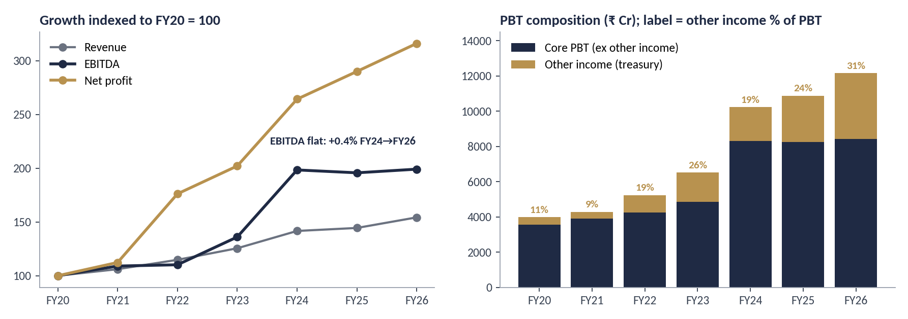
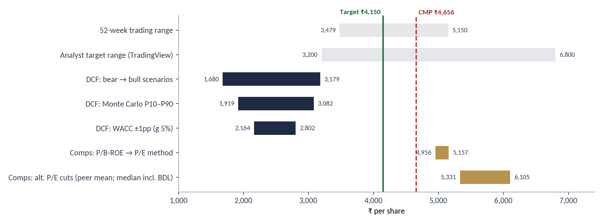
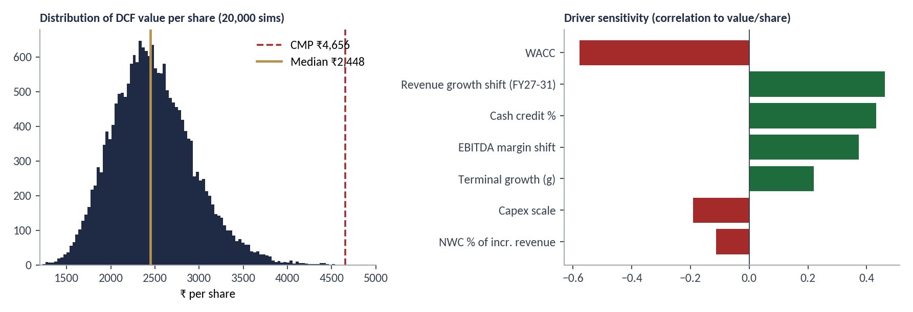

# Hindustan Aeronautics Ltd (HAL): Independent Equity Research

**Rating: HOLD (Neutral) | 12-month target: ₹4,150 | CMP: ₹4,655.60 (9-Oct-2026) | Downside: 10.9%**

An initiating-coverage report on HAL (NSE: HAL | BSE: 541154) with the full model behind it: a live Excel workbook and a Python Monte Carlo. The question the report asks is not whether HAL is a good business, but what the price already assumes.

> Educational / portfolio project. Not investment advice.

---

## The finding

| | |
|---|---|
| **+0.4%** | EBITDA growth FY24→FY26, while net profit grew 19.6% |
| **31%** | of FY26 pre-tax profit is other income (interest on deposits funded by customer advances); 43% in Q1 FY27 |
| **~49x** | P/E on core earnings (excluding treasury income) |
| **8.3%** | cost of equity implied by the price (reverse DCF), vs 11.75% assumed |



## Valuation summary

| Method | ₹/share | vs CMP |
|---|---|---|
| DCF, base case (WACC 11.75%, g 5.0%) | 2,435 | −47.7% |
| Comps (peer P/E and ROE-adjusted P/B) | 5,056 | +8.6% |
| Monte Carlo DCF, median of 20,000 paths | 2,448 | cross-check |
| Blended fair value (50/50) | 3,746 | −19.5% |
| **12-month target** (× 1 + Ke − dividend yield) | **4,150** | **−10.9%** |

Rating bands, fixed before weights were applied: BUY ≥ +15%, REDUCE ≤ −15%, HOLD otherwise.



**The rating depends on two stated judgements:**
1. **DCF/comps weight (50/50).** At 0% DCF weight the target is ~₹5,600 (BUY); at 65% it is ~₹3,710 (REDUCE). The full range is in the `Valuation` sheet.
2. **Cash credit (50%).** HAL's ₹42,425 Cr of deposits is almost matched by ₹44,689 Cr of non-current customer advances, so only half is credited in the equity bridge. The range is ₹2,083 (0%) to ₹2,787 (100%) per share.

## Repository contents

| File | Description |
|---|---|
| `HAL_Equity_Research_Report.pdf` | 9-page report: thesis, company, industry, financials, valuation, catalysts, risks, appendix |
| `HAL_Model.xlsx` | Live model, ~585 formulas, zero errors on recalculation |
| `hal_monte_carlo.py` | 20,000-path Monte Carlo DCF (seed 42) |
| `figures/` | Charts used in the report |
| `requirements.txt` | Python dependencies |

### Workbook sheets

| Sheet | Contents |
|---|---|
| Summary | Rating, target, key outputs, financial summary |
| Historical | FY20–FY26 P&L, balance sheet, cash flow, derived ratios, order book, quarterly data |
| Assumptions | Market data, WACC build-up, forecast drivers, scenario overlays |
| Forecast | FY27E–FY36E revenue, EBITDA, FCFF, EPS |
| DCF | Mid-year discounting, terminal value, equity bridge, WACC×g and cash-credit sensitivities, reverse DCF |
| Comps | Peer multiples, implied values |
| Valuation | Weights, target price, rating, weight sensitivity |
| MonteCarlo, Scenarios | **Static** outputs pasted from Python |
| Notes | Sources and limitations |

Blue = input, black = formula, green = cross-sheet link, yellow fill = key judgement.

## Method

- **DCF:** 10-year FCFF (FY27E–FY36E), mid-year convention, Gordon terminal value. Treasury income is excluded from FCFF. Revenue CAGR is 9.4% (11–13% in FY27–29, fading to 6%); EBITDA margin is 29.5% then 30% (below the 30–31% guided); capex fades from 7.5% to 5.5% of revenue; working capital is 10% of incremental revenue; tax is 25%.
- **Cost of equity:** risk-free 7.0% (10Y G-Sec), beta 0.95, equity risk premium 5.0% → 11.75%. Debt is negligible, so WACC = Ke.
- **Comps:** median P/E of four peers (BEL, Mazagon Dock, GRSE, Cochin Shipyard) × HAL TTM EPS, averaged with an ROE-adjusted P/B method. Bharat Dynamics is excluded as an outlier on depressed earnings.
- **Reverse DCF:** solves for the discount rate, growth or margin at which the DCF equals the price. To justify ₹4,656 at 11.75% would need ~20% revenue CAGR for ten years (vs 9.4% modelled).
- **Monte Carlo:** randomises WACC, terminal growth, revenue growth, margin, capex, working capital and cash credit. Median ₹2,448; 5th–95th percentile ₹1,788–₹3,299; 3 of 20,000 paths exceed the current price.



## Run the Monte Carlo

```bash
pip install -r requirements.txt
python hal_monte_carlo.py
```

Outputs `hal_mc_results.json`, `hal_mc_values.npy` and `hal_mc_chart.png`. Inputs at the top of the script mirror the `Assumptions` sheet, so change them in both places to keep the model and simulation consistent.

## Data sources

- Financials, ratios, shareholding: Screener.in consolidated statements (from company filings), retrieved 10-Oct-2026
- Price: NSE close 9-Oct-2026
- Order book, guidance, capex, R&D, exports: HAL Q4 FY26 earnings call and Q1 FY27 coverage
- Customer advances and deposits: FY26 annual-report analysis (standalone)
- Budget and production data: PIB and industry reports; 10Y G-Sec from Trading Economics
- Peer multiples: Screener.in and Value Research (1–9 Oct 2026)

## Limitations

- Consolidated model, not built bottom-up by programme or segment.
- Peer multiples come from public aggregators and may differ slightly from exchange data; there are only four clean comparables.
- Monte Carlo and scenario outputs are static snapshots from Python, not live formulas.
- The cash credit and the DCF/comps weights are explicit judgements. Their full ranges are shown, not hidden.
- FY26 consolidated revenue is ₹33,089 Cr on Screener's basis vs ₹33,050 Cr in HAL's call material.
- The report was written on 10 Oct 2026 and is not updated for later results.

## Disclaimer

This repository is an independent learning project. It is not investment advice or a solicitation to buy or sell any security. The author may or may not hold positions in the securities discussed. Verify all data before relying on it.

## Author

[Your Name] | [LinkedIn] | [Email]
